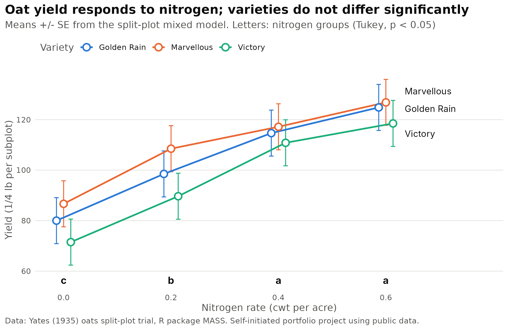
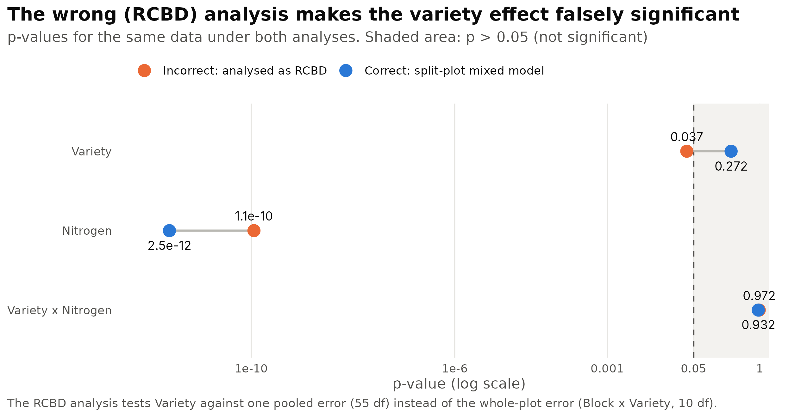
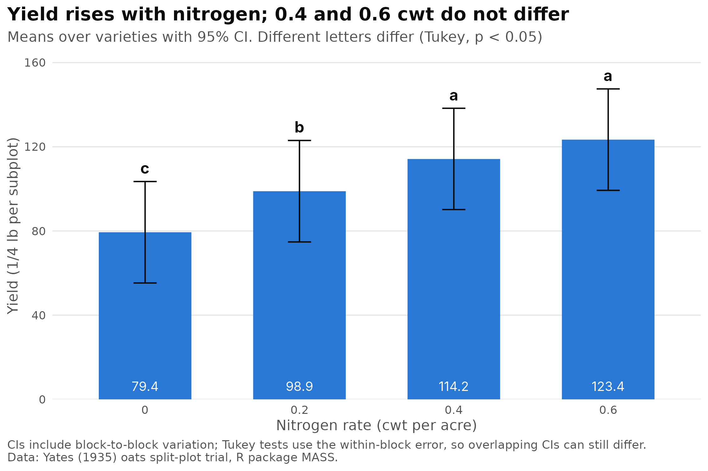
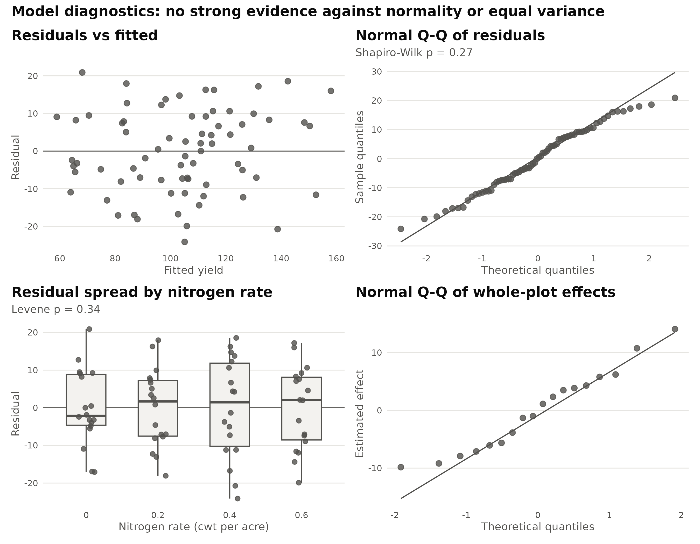

# Getting the Split-Plot Right: Oat Variety × Nitrogen Field Trial

*Self-initiated portfolio project using public data.*
Author: Utik Tri Wulan Cahya, PhD

Split-plot experiments are common in agronomy, and they are often analysed incorrectly as simple randomized complete block designs (RCBD). This project shows the correct analysis of a split-plot field trial with a linear mixed model in R, and compares it with the common incorrect approach to show how the wrong error term changes the conclusions.



## Data

The classic oats experiment of Yates (1935), distributed as `oats` in the R package **MASS** (Venables & Ripley).

| Item | Detail |
|---|---|
| Blocks | 6 |
| Whole-plot factor | Variety (Golden Rain, Marvellous, Victory), randomized within blocks |
| Subplot factor | Nitrogen: 0, 0.2, 0.4, 0.6 cwt per acre, randomized within each whole plot |
| Response | Grain yield (¼ lb per subplot, original units) |
| Observations | 72 (6 blocks × 3 varieties × 4 nitrogen rates) |

## Methods

1. **Design check:** confirmed 6 × 3 whole plots, each split into 4 nitrogen subplots.
2. **Incorrect analysis (for comparison):** two-way ANOVA with blocks, as if the trial were an RCBD (`aov(Yield ~ Block + Variety * Nitrogen)`).
3. **Correct analysis:** split-plot ANOVA with two error strata (`Error(Block/Variety)`), and the equivalent linear mixed model:
   `lmer(Yield ~ Variety * Nitrogen + (1 | Block) + (1 | Block:Variety))`, with Kenward-Roger F tests.
4. **Assumption checks:** residual plots, Shapiro-Wilk test, Levene's test, and a Q-Q plot of the whole-plot random effects.
5. **Treatment comparisons:** estimated marginal means (`emmeans`), Tukey-adjusted pairwise comparisons with compact letter displays, and orthogonal polynomial contrasts for the quantitative nitrogen factor.

## Key results

| Effect | Incorrect RCBD analysis | Correct split-plot mixed model |
|---|---|---|
| Variety | F = 3.51, p = 0.037 (error df = 55) | F = 1.49, **p = 0.27** (error df = 10) |
| Nitrogen | F = 26.25, p < 0.001 | F = 37.69, p < 0.001 |
| Variety × Nitrogen | F = 0.21, p = 0.97 | F = 0.30, p = 0.93 |

- **The wrong analysis would lead to a wrong conclusion.** Treated as an RCBD, varieties appear to differ significantly (p = 0.037). In the correct analysis, variety is tested against the whole-plot error (Block × Variety, 10 df), and the difference is **not significant** (p = 0.27).
- **Nitrogen strongly increased yield** (p < 0.001): from 79.4 at 0 cwt to 123.4 at 0.6 cwt. The response is mainly linear (linear contrast p < 0.001; quadratic p = 0.11). Yields at 0.4 and 0.6 cwt did not differ significantly (Tukey).
- **No variety × nitrogen interaction:** all three varieties responded to nitrogen in a similar way.
- **Variance components:** blocks 43%, whole-plot error 21%, subplot error 36% of the total variance, which confirms that the two error levels are clearly different.
- **Assumptions:** no strong evidence against normality (Shapiro-Wilk p = 0.27) or equal variance across nitrogen rates (Levene p = 0.34). Residual spread across varieties was borderline (Levene p = 0.06) and was noted.



## Files

| File | Content |
|---|---|
| `splitplot_analysis.R` | Full, commented analysis script |
| `oats.csv` | Data used (exported from `MASS::oats`) |
| `model_output.txt` | Complete console output, including session info |
| `anova_comparison_rcbd_vs_splitplot.csv` | ANOVA results: incorrect RCBD vs correct split-plot |
| `means_nitrogen_tukey.csv`, `means_variety_tukey.csv` | Means with Tukey letter groupings |
| `nitrogen_polynomial_contrasts.csv` | Linear, quadratic and cubic nitrogen contrasts |
| `cell_means_variety_x_nitrogen.csv` | Variety x nitrogen means |
| `variance_components.csv` | Block, whole-plot and subplot variance |
| `fig1` to `fig4` (`.png`) | Publication-ready figures (300 dpi) |
| `splitplot_case_study.pdf` | Three-page case study |





## How to reproduce

```r
install.packages(c("MASS", "lme4", "lmerTest", "pbkrtest", "emmeans",
                   "multcomp", "multcompView", "car", "ggplot2", "patchwork"))
```

Then, from the project folder:

```
Rscript splitplot_analysis.R
```

The script loads the data from the MASS package and writes all tables and figures to a new `output/` folder.

Analysed with R 4.3.3; package versions are listed at the end of `output/model_output.txt`.

## Reference

Yates, F. (1935). Complex experiments. *Supplement to the Journal of the Royal Statistical Society*, 2(2), 181–247.
Venables, W. N., & Ripley, B. D. (2002). *Modern Applied Statistics with S* (4th ed.). Springer.
